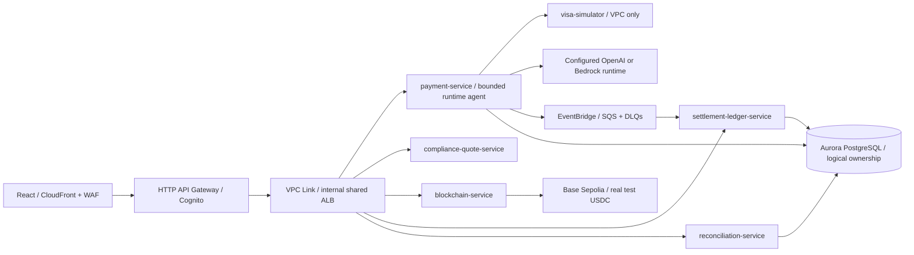

# Solution Architecture and Design - living document

Current delivery status (2026-11-15): **9 of 11 steps code-complete**.
Connected UI setup and exact screen actions are in [the step-9 guide](32-CONNECTED-REACT-WORKSPACE.md).
Step 11 preparation and Codespaces acceptance now precede AWS application deployment; live proof and the rendered Word artifact remain pending.

Status: IN PROGRESS. Updated alongside implementation. A component being designed
or compiled does not establish deployed infrastructure, model access or settlement.

## Product and architecture baseline

A configurable AWS-native stablecoin payment and treasury platform for corporate
USD funding, evidence-driven routing, real public-testnet USDC settlement,
optional simulated fiat payout, immutable control-ledger journals and reconciliation.
The primary demonstration is USD 10,000. ETH pays gas; USDC is not swapped to ETH.

Authoritative sources: [engineering contract](../AGENTS.md),
[accepted routing architecture](../adr/ADR-014-STABLECOIN-AGENTIC-ROUTING.md),
[accepted accounting](../adr/ADR-015-PER-ASSET-POC-ACCOUNTING.md),
[delivery plan and executed checks](21-AGENTIC-STABLECOIN-DELIVERY-PLAN.md).

## Component design and responsibilities

| Existing component | Responsibility | Required final documentation |
|---|---|---|
| React / TypeScript | Intent, route/agent evidence, approval, treasury, chain, ledger and reconciliation views | Screen map, API bindings, errors, accessibility and demo captures |
| payment-service | Authenticated intent/policy, recommendation/review, bounded model runtime and protected orchestration | State/sequence diagrams, command authority, approval/replay handling |
| compliance-quote-service | Simulated compliance, FX/fee quotes and provider observations | Quote scope, freshness, simulation controls and contract |
| blockchain-service | Real testnet readiness/reservations, signing, submission/recovery and receipt confirmations | Wallet/nonce lifecycle, gas components, unknown-outcome recovery |
| settlement-ledger-service | Immutable per-asset postings and accounting policy | ADR-015 templates, atomicity, precision, reversals and provenance |
| visa-simulator | VisaPaymentAdapter with simulated provider liquidity and payout | Provider reservation and success/failure/unknown outcomes |
| reconciliation-service | Deterministic payment/chain/ledger/payout comparison | Per-leg checks, discrepancies, evidence and exception handling |

## Deployment target and shared configuration

AWS ECS Fargate, API Gateway, Aurora PostgreSQL, EventBridge/SQS with DLQs,
CDK TypeScript, Cognito identity and Secrets Manager/KMS. No extra microservices,
Kubernetes, Kafka or initial custom smart contract. Final document must include
network/IAM boundaries, service topology, database ownership, event routing,
monitoring, backup/recovery, deployment commands and operational costs.

All connections use [shared configuration](23-SHARED-CONNECTION-CONFIGURATION.md).
[Runtime agent design](27-RUNTIME-INTENT-AND-ROUTING-AGENT.md) covers direct OpenAI
or compatible OpenAI models on Bedrock, authorization, tool/iteration/token/cost
limits and disabled-by-default activation. Provider changes currently require a
restart. The model may gather read-only evidence and explain eligible options;
it cannot approve, sign, submit, pay out or post journals.

## Evidence and mode boundary

Real application ledger and reconciliation are distinct from real testnet token
movement. Fiat funding, conversions, compliance, FX, Visa and beneficiary bank
credit remain simulated. Preserve mode and provenance at every screen, journal,
event, reconciliation result and exported evidence artifact. Never describe a
mock transaction as a public-testnet result or a control book as a full custody GL.

## Completion checklist - update at each implementation step

- Capture design decisions and accepted ADR links; document material assumptions.
- Update API/event schemas, ownership, idempotency scope and state transitions.
- Record failure paths, retries/timeouts, DLQs and unresolved-outcome handling.
- Record security, configuration, secret references and deployment implications.
- Record actual verification, skips, access dependencies and remaining work.
- Add the corresponding demonstration steps and expected evidence to the
  [prototype execution runbook](29-PROTOTYPE-EXECUTION-RUNBOOK.md).
- Before final delivery, complete architecture/deployment/data/sequence diagrams,
  screen coverage, operations and known limitations; replace planned sections with
  actual implementation references and executed results.

## Current implementation note

ADR-015 accepted by owner on 2026-11-14. Ledger templates and controls are implemented and unit-verified: 67 checks passed,
ten PostgreSQL tests skipped without Docker. Approved chart, precision, atomic
commands, replay guards and provenance are specified in [ledger design](10-LEDGER.md).
Funding/submission/confirmation consumers, the payment-owned funding producer and bound POSTED journal acknowledgements are implemented. Step 8 also connects complete actual receipt-fee settlement, simulated USD/INR payout and immutable reconciliation. Actual database execution and full live acceptance remain pending.
Steps 7-9 now have code implementations; their live acceptance and steps 10-11 remain delivery work. No live model, AWS deployment or full public-testnet
payment is established by the current unit/stub verification.

## Shared identity and evidence access design

`services/platform-security` is a reusable Java library packaged into the existing
six services. It is not another process, endpoint, or microservice. Existing
payment-service Cognito verification and server-owned subject/customer/role
membership logic were extracted for reuse; payment API contracts retain their
existing compatibility classes. The payment service retains its review-specific
filter chain; the other services use the library's default chain.

Identity settings remain in `services/config/connections.properties`. Configure
HTTPS issuer/JWKS, public client, optional audience and bounded HTTP timeout.
Unconfigured identity rejects protected requests. `/health` remains public.
Every configured internal caller must use a distinct confidential Cognito client
(`IDENTITY_SERVICE_CLIENT_ID`) and the configured resource-server scope
(`IDENTITY_SERVICE_SCOPE`, default `stablecoins/internal`). A browser token carrying
that scope does not acquire service authority. JWT signature, issuer, expiry,
access-token type and allowed client are checked before authorities are used.
Configuring these settings does not provision a client or obtain a service token;
Cognito provisioning and the outbound client-credentials integration remain work.

Internal paths and blockchain commands require the internal client plus scope.
Manual ledger writes additionally retain their disabled-by-default application
gate. Customer evidence reads use the verified subject's server-owned operator
membership and a parameterized, read-only payment/account ownership lookup.
This cross-service read follows accepted ADR-007; only the owning service writes
its tables. Payment-ID and journal/transaction-ID reads both apply ownership.
Foreign/missing payments return `PAYMENT_NOT_FOUND`; an unavailable ownership
store fails closed with `EVIDENCE_STORE_UNAVAILABLE`. No request-provided customer
or role grants access. Member configuration must be supplied consistently to
services through the shared external configuration mechanism.

Container definitions include all reactor POMs and the library sources. Actual
Docker image builds and live Cognito/M2M connectivity still need execution.

## Event transport and accounting integration

Ledger funding uses the documented version 2.0 simulated funding contract, with
immutable quote/conversion amounts and beneficiary outcome. Submission and
confirmation consumers validate network/chain, amount, transaction hash and
payment/correlation binding against that accounting context. Missing earlier
legs cause retry/review, not invented financial evidence. Ledger postings retain
REAL_TESTNET or MOCK chain provenance independently of simulated conversion.

EventBridge targets forward `$.detail`, the domain envelope expected by Java
consumers. Funding, submitted and confirmed events each have a queue and DLQ.
There are six routes and twelve queues including DLQs. Local bootstrap establishes
the same redrive policy even when a listener created the queue first. AWS CDK
currently implements messaging; the compute/data/API topology below is the
accepted deployment target, not deployed evidence.

## Documentation coverage and final delivery gate

For each row, maintain the design, configuration/security boundary, exact demo
procedure, expected artifacts, failure procedure and executed verification. A
feature may be implemented while its connected demonstration remains pending.
The feature IDs match the runbook and stay stable as implementation evolves.

| Feature ID | Required design coverage | Required runbook/evidence coverage | Current remaining work |
|---|---|---|---|
| F01 | Intent, ownership, idempotency and state model | USD 10,000 instruction and duplicate/conflicting request | Implemented in steps 7-9; live acceptance pending |
| F02 | Simulated compliance, quote scope/expiry and FX/fees | Simulation labels, accepted quote, rejection/expiry | Producer and UI implemented; live demonstration pending |
| F03 | Agent tools, seven signals, bounded inference, model configuration | Actual runtime trace, explanation, limits and provider/cost evidence | Runtime and producers implemented; live model evaluation pending |
| F04 | Independent review and execution authority | Different operator/approver; stale/replayed approval | Integrated; database and authenticated acceptance pending |
| F05 | Simulated funding, per-asset conversion and treasury reservations | USD/USDC journals, USDC balance, ETH gas estimate, low liquidity | Integrated; actual database/treasury execution pending |
| F06 | Signing, durable submission claims, nonce/hash and confirmations | Genuine explorer hash/receipt; unknown/reverted recovery | Fee extraction implemented; full public-testnet execution pending |
| F07 | Immutable control book, approved templates and compensating entries | Per-asset balance, replay/conflict, precision, linked reversal | PostgreSQL execution and full event lifecycle |
| F08 | VisaPaymentAdapter and simulated payout outcomes | Labeled USD/INR bank credit; failed/unknown payout | Backend and UI implemented; connected payout run pending |
| F09 | Deterministic per-leg reconciliation and exceptions | Matched result and injected mismatch/incomplete evidence | Backend and UI implemented; database/integrated acceptance pending |
| F10 | Customer policies, shared identity/connections and AWS deployment | Second customer, denied foreign reads, setup/deploy/operations | Two customer examples prepared; live identity/customer proof and full infrastructure pending |

Final architecture deliverable must include actual component/deployment/data and
sequence diagrams, API/event/state contracts, data ownership, agent/service
boundaries, security/IAM/secrets, resilience, observability, cost assumptions,
operations/recovery and limitations. Final runbook must include prerequisites,
exact build/start/deploy and feature steps, expected screenshots/API evidence,
negative cases and supported reset. Both remain IN PROGRESS until their coverage
and executed evidence are complete; commercial opportunity remains a hypothesis
until supported by customer/market validation.

## Final Word document requirement

At final implementation delivery, produce a separate Word document named
`StableCoins-Solution-Architecture-and-Design.docx`, consolidated from all relevant
repository documentation, accepted ADRs and actual implementation evidence. It
must cover earlier, current and subsequent increments, not only the latest step.
Include revision/date, source-document/ADR index, clear current-versus-target
status, diagrams, configuration/security, APIs/events/data, agent boundaries,
accounting, deployment/operations, verification and limitations. Resolve obsolete
examples against accepted decisions; do not silently present proposed ADR-013 as
accepted. Preserve the Markdown documents as living sources and refresh the Word
artifact for final delivery. Render and visually inspect every page before release.
The full demonstration runbook remains separately maintained and is cross-referenced.
This Word artifact is a tracked final deliverable; it has not yet been generated.

GitHub Codespaces is the intended container execution environment because the
current local machine lacks container capability. Use the existing dev-container
and [container/Codespaces guide](18-CONTAINERIZATION-CODESPACES.md); actual remote
container, database and integrated feature runs must be recorded when executed.

## Earlier verification record - access/container increment (2026-11-14)

All six Java applications and the shared security library compiled/packaged in a
full Java 21 Maven verify run. 453 Java cases passed, zero failures/errors, 39 skipped (PostgreSQL/Docker and one opt-in real-model check).
Totals deduplicate Surefire/Failsafe reports by module/test class, selecting the
latest report. Eleven shared configuration checks and nine CDK checks passed.
The six packaged JARs include byte-identical current shared configuration and the
security library. Dev-container JSON, six Docker build contexts and updated local
documentation links were checked without starting containers.

This increment reuses identity/membership validation, protects internal commands
and customer ledger/chain evidence, and updates applicable API/security/service/ADR
notes. Codespaces retains the existing Docker-in-Docker setup; global placeholder
AWS credentials and the incorrect container localhost default were removed.
The sample LocalStack endpoint is blank so Compose uses its service DNS default.

Assumptions: six deployables; accepted ADR-007 permits read-only ownership joins;
internal callers use a distinct Cognito client plus scope; ADR-015 is an operational
control ledger, not a full custody GL. Remaining work includes service-token
acquisition, trusted quote/funding producer and ledger acknowledgement, payout and
reconciliation wiring, connected React UI, complete AWS infrastructure, and actual
Cognito/model/PostgreSQL/public-testnet execution. The final Word deliverable is
tracked and not yet generated. That record preceded step 7; see the current step-7 section below for updated status.

## Step 7 implementation design

[Approved wallet integration](30-PAYMENT-FLOW-INTEGRATION.md) adds the shared
platform-flow library and owner-service evidence/command workflow. It preserves
all previous intent, security, assessment, treasury, agent and accounting controls.
Two configured simulated provider quotes can produce different lowest-cost and
fastest recommendations; observed treasury liquidity retains LIVE/MOCK mode.
The actual model explains captured source records without financial mutation tools.

Preparation and execution are durable, scoped and idempotent. Fresh holds cannot
expand the reviewed ETH reserve or change custody/network/recipient/mode. Simulated
USD debit, audited state changes, recommendation execution and funding outbox are
one payment transaction. Three exact ledger-owned posted legs gate submission.
Nonce/hash claims and receipt recovery remain authoritative in blockchain-service.
Unknown signed work is monitored rather than rerouted. Receipt polling uses a
scheduler pool so it does not block the sole outbox thread.

This design currently connects wallet confirmation. It does not assert complete
network-fee accounting, optional fiat delivery, final settlement or reconciliation.
The cumulative feature matrix/runbook must retain those step-8 gates and the later
connected React/AWS/hackathon work. The final Word document must incorporate this
sequence, owner-table inventory, configuration, tests and actual run evidence.

## Step 7 verification (2026-11-14)

Java 21 full-reactor `verify` completed successfully and packaged all six services
plus the two shared libraries. Latest Surefire/Failsafe reports, deduplicated by
module/test class, contain 544 cases: **502 passed, 0 failures/errors, 42 skipped**.
The skips are 41 database/container cases and one opt-in real-model evaluation.
These skips do not validate migrations, SQL concurrency or live inference.

The Node wallet-verifier/shared-configuration checks passed **21/21**. CDK TypeScript
build passed and its messaging/container tests passed **10/10**. Receipt tests use
fixtures; they do not prove a public transfer. No Docker images, PostgreSQL stack,
Cognito token flow, model call, AWS deployment or public-testnet wallet flow ran.
See [wallet integration](30-PAYMENT-FLOW-INTEGRATION.md) for opt-in Codespaces setup.

Assumptions remain the accepted six-service/shared-schema/operational-subledger
architecture. No new money-authorizing agent or deployable was added. Next: step 8
fee-complete settlement, optional simulated payout and reconciliation; steps 9-11
cover the connected UI, AWS runtime and final hackathon/documentation delivery.

## Presenter walkthrough contract

The [screen-by-screen runbook](29-PROTOTYPE-EXECUTION-RUNBOOK.md#opening-narrative-the-complete-payment-story)
starts with the full traditional-finance/blockchain/traditional-finance story,
then specifies each screen, signed-in role/persona and purpose, the reason before
each navigation/click, and its expected and observed outcome. The connected React workspace implements these screens in step 9. The runbook
uses the actual routes and labels; step 11 must execute and capture the live flow.
The final Word architecture/design deliverable must incorporate or cross-reference
this same complete walkthrough, including roles, evidence and recovery procedures.

## Step 8 design increment - 2026-11-15

[Settlement, payout and reconciliation design](31-SETTLEMENT-PAYOUT-RECONCILIATION.md)
is part of this cumulative architecture document. Its sequence, permissions,
configuration, owner-table inventory and failure handling supersede earlier
statements that step-8 backend integration is pending. The six-service topology,
AWS targets, accepted ADRs and bounded read-only model authority are unchanged.

For bank intents, provider fiat is pinned before simulated USD funding. Ledger
acknowledgements gate signing, settlement and payout completion. Actual complete
receipt fees are distinct from estimates; incomplete L2 fees block final closure.
The wallet path has six approved journals; optional simulated USD/INR payout adds
three. Reconciliation independently reads canonical records, stores an immutable
repeatable-read report and findings, and never repairs another owner's tables.
The payment owner requires a current matching evidence fingerprint before
RECONCILED. Failed/unknown payouts do not imply bank credit or a customer refund.

New owner data: payment_closure; blockchain fee components/confirmation depth;
settlement-to-fee/confirmation journal links; visa_transaction and visa_payout_audit;
reconciliation and reconciliation_detail. New five queue/DLQ pairs retain existing
EventBridge/SQS contracts. No new microservice, accounting engine or smart contract.

Architecture assumptions: shared-schema reads per ADR-007/008; notional USD/USDC
1:1; illustrative configured INR rate; captured simulated provider capacity and
scenario; conservative receipt completeness. Institutional MPC/HSM custody,
production off-ramp/FX, statutory accounting, orphan-hold operations and commercial
validation remain explicit evolution or operational work, not implemented claims.

The final Word export at step 11 must include this increment, all earlier design
chapters, accepted ADRs, role/action demo sequence, actual validation results and
remaining limitations. This living Markdown remains the source while UI,
deployment and final proof are being completed.

## Step 8 coding and verification - 2026-11-15

Steps **1-8 of 11** now have code-level implementations. Three delivery steps
remain: connected React experience (9), completed AWS deployment/operations (10),
and recorded end-to-end proof, commercial/demo package and final Word architecture
and design document (11). Step 10 already has partial shared security/messaging
foundations. Code completion does not establish live acceptance.

The final Java 21 full reactor `verify` succeeded. Combined with the targeted
blockchain verification, latest XML reports counted once per module/test class
contain **600 cases: 546 passed, zero failures/errors, 54 skipped**. Those skips
are **53 container/database cases and one opt-in real-model evaluation**. Visa
and reconciliation database suites are now bound to `verify`; blockchain DB
suites were explicitly discovered in the targeted run. None of these skipped
cases establishes SQL migration, locking, rollback or six-service acceptance.

The synthetic loopback HTTP test actually exercised Web3j/Spring Jackson
compatibility and raw receipt fee parsing. Recovery tests verify filling a missing
price only for the same mined transaction, rejection of conflicting known evidence,
and no additional signing/submission. All data in that HTTP test is synthetic.

Node verifier/configuration tests passed **30/30**. CDK TypeScript build passed;
its infrastructure/configuration tests passed **11/11**. All six packaged JARs
were checked for the current common configuration and shared workflow library.
Markdown relative-file links and fenced-code balance were checked.

Docker images, PostgreSQL execution, live Cognito, real model inference, AWS
deployment and a public-testnet end-to-end transfer did not execute locally.
[Machine-readable results](step8-build-results.json) retain the exact test scopes.
[Implementation, configuration, APIs and demo/recovery procedure](31-SETTLEMENT-PAYOUT-RECONCILIATION.md)
cover the completed increment. The existing agent runtime and deterministic
financial services are reused; the model receives no money-authorizing tools.

## Step 9 connected application design - 2026-11-15

The React starter is replaced with the connected StableFlow workspace. The current
[screen/API/security/recovery design](32-CONNECTED-REACT-WORKSPACE.md) and
[role/context/action/outcome runbook](29-PROTOTYPE-EXECUTION-RUNBOOK.md) supersede
earlier proposed-screen descriptions. Identity uses configured PKCE public-client
endpoints, memory-only access tokens and server-owned customer membership/roles.
The thin payment-service read projection authorizes ownership first and reuses
shared canonical read models under ADR-007/009; the Visa simulator stays private.
Financial commands, agent boundaries and six-service architecture are unchanged.

Decimal strings preserve ledger/wei precision; display-only BigInt checks never
replace LedgerPostingService. The browser preserves unresolved idempotency keys,
performs no automatic POST retries and never signs a transfer or authorizes an
agent to mutate money. Evidence views label simulation, mock, live, pending and
review-required states. Exports omit tokens/configuration/secrets. Actual public
receipt verification remains required independently of displayed application data.

Remaining delivery work is completed AWS hosting/operations (10), then live proof,
commercial demonstration package and cumulative Word architecture/design document
(11). The final document must include all earlier increments plus these identity,
UI contracts, operational limits, runbook actions and observed verification scopes.

## Step 9 coding and verification - 2026-11-15

Steps **1-9 of 11** are code-complete. Two delivery steps remain: completed AWS
deployment/operations (10), then live acceptance/proof, the commercial/hackathon
demo package and final cumulative Word architecture/design document (11).

The connected React workspace implements authenticated customer views, confirmed
USD intents, seven-signal provider evidence, actual bounded-agent run records,
quote/version acceptance and independent approvals, treasury gas readiness,
authorized execution, chain receipts/fees, immutable journals, reconciliation and
optional simulated payout. Existing owner services and financial controls are reused.
The new payment-service read projection checks ownership before cross-owner reads;
the Visa simulator stays private. Connection settings remain centralized, including
public identity endpoints and the configured chain/explorer metadata.

The Java 21 full-reactor `verify` succeeded: **602 cases, 555 passed, zero failures/
errors, 47 skipped**. Those skips are 46 Docker/database cases and one opt-in model
evaluation. The latest combined historical reports contain 609 cases with the
same 555 passes and 54 skips; the extra seven are previously discovered/skipped
blockchain container cases, not new execution evidence. All six service packages
were refreshed after the final public configuration update and checked for the
current shared configuration and workflow library.

The frontend production build and lint pass without warnings. The combined Node
suite passes **45/45**. The headless browser rehearsal passes **19/19**
checks against an explicitly synthetic HTTP fixture. It exercises an uncertain
creation response, persistent warning and same-key replay; server-role UI gates;
separate approvers; agent display; execution; honest MOCK evidence; exact ledger
amounts; safe configured explorer links; mobile layout and session clearing.
Desktop/mobile synthetic screenshots were inspected; they are not live proof.

No Docker stack, PostgreSQL integration, live Cognito/model, AWS deployment or
public-testnet end-to-end transfer executed. See the [machine-readable scopes](step9-build-results.json),
[UI implementation/setup](32-CONNECTED-REACT-WORKSPACE.md) and
[complete role/screen/action runbook](29-PROTOTYPE-EXECUTION-RUNBOOK.md).

## Step 10 sequencing: local validation first

The owner requested local application testing before AWS deployment.
[The local validation guide](33-LOCAL-FIRST-VALIDATION.md) documents the new portable
preflight/build/test/start/access-probe helper, local shared-schema initialization,
loopback port exposure and staged acceptance. It reuses all six services and the
existing financial and agent implementations. No production architecture change,
AWS deployment or local full-payment success is implied. Step 10 remains in progress;
final cumulative Word delivery is retained in step 11.

## Local-first increment: executed verification

The final local helper run completed PASSED_WITH_SKIPS: **555 Java tests passed,
47 skipped, zero failures/errors** (602 cases in this invocation). The skips are
46 Docker/PostgreSQL cases and one explicitly optional live-model case. The strict
database gate is NOT_SATISFIED. All **54 Node tests and 12 CDK tests passed**;
React production build/lint and infrastructure TypeScript build passed. All six
packaged applications contain the current shared connection file and security
library. The 64 Markdown files have no broken local file links or unclosed fences.
See [the machine-readable local record](step10-local-build-results.json).

A real startup attempt stopped at the missing Docker/Compose prerequisite before
invoking Compose. Six-service startup, migrations/concurrency, authenticated
payment closure, actual model and public-testnet acceptance remain unexecuted.
No AWS deployment occurred. Step 10 is in progress; nine of eleven delivery steps
remain code-complete. The earlier browser checks remain synthetic step-9 evidence
and were not rerun for this local tooling increment.

## Step 11 preparation and selected deployment destination

The owner selected GitHub repository kirankumarns-Cognizant/StableCoins and
AWS account 640237069320 in us-east-1, using IAM Identity Center. SSO directory
Region and assigned permission set are not yet confirmed. Resource provisioning
and actual sign-in remain pending. The application is to be accepted in Codespaces
before deployment to AWS; this changes delivery order, not accepted architecture.

The [launch guide](34-CODESPACES-DEMO-LAUNCH.md) and
[proof package](35-HACKATHON-PROOF-PACKAGE.md) consolidate prerequisites, precise
UI navigation, two customer policies, comparable baseline, controlled simulated
outage, commercial assumptions and proof gates. Optional identifiers extend the
existing fictional seed rather than adding duplicate business services. Neither
policy can grant the model financial authority. Live evidence and the cumulative,
rendered Word artifact remain outstanding; preparation is not step completion.
